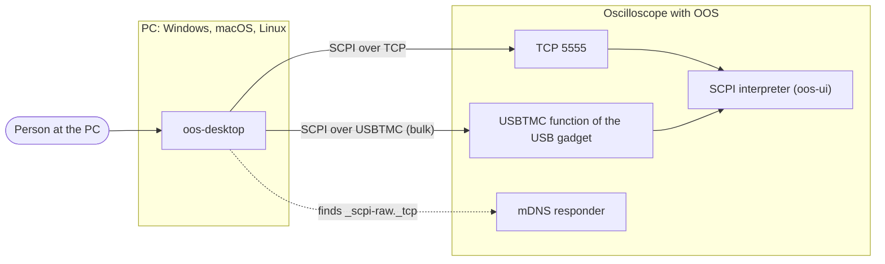
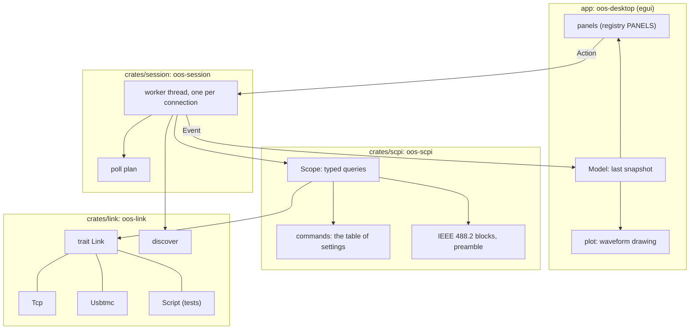
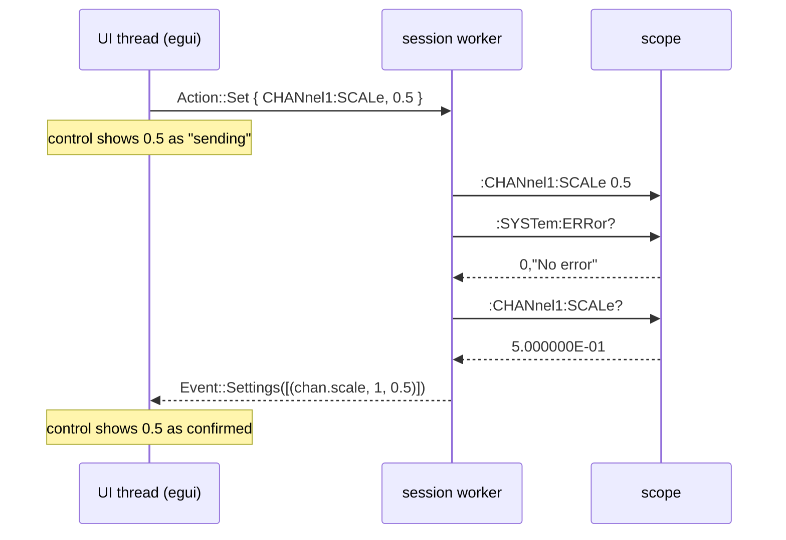

# Architecture

oos-desktop is a program for Windows, macOS and Linux that controls an oscilloscope running
[OOS](https://github.com/dekajoule/oos) and shows what it records: over the network (SCPI on TCP port 5555) or over a
USB cable (USBTMC). This page says how the pieces fit, why they are cut where they are, and where a change goes. The
decisions behind it are in [docs/adr](adr/README.md).

## 1. What it is, and what it is not

- **A client of the scope's remote interface.** Everything it knows about the scope it learns through SCPI, and
  everything it changes it changes through SCPI. OOS documents that interface in its
  [docs/scpi.md](https://github.com/dekajoule/oos/blob/main/docs/scpi.md); this program uses nothing else (ADR 0002).
- **Not a second scope.** The scope measures, decodes and keeps the settings. The program shows what the scope answers.
  It may compute what only the display needs, such as min/max per pixel column of a long record, but no measurement the
  scope already makes (ADR 0002).
- **Not a replacement of the web remote.** The web remote of OOS (port 8080) stays the way to reach a scope from any
  browser. This program is for the desktop: a large live waveform, the controls beside it, records saved as files, and
  the USB cable when there is no network.

## 2. Context

Sources: `crates/link/src/tcp.rs`, `crates/link/src/endpoint.rs`; USBTMC and discovery are planned (section 10).

Both ways reach the same interpreter in the scope (OOS ADR 0022), so the program speaks one language over both and the
transport is a detail of one crate.

## 3. The parts

Sources: `app/src/`, `crates/session/src/`, `crates/scpi/src/`, `crates/link/src/`.

The arrows only point down: `app` uses `session`, `session` uses `scpi` and `link`, `scpi` uses `link`. Nothing calls
upwards, and `app` does not use `scpi` or `link` directly; it sees their types only where `session` hands them on
(ADR 0003). `tools/check.sh` (layer `layers`) fails when a crate names a crate above it or skips one it may not.

### 3.1 `oos-link`: bytes to and from one scope

- `trait Link`: `send(&[u8])`, `recv(deadline) -> Message`, `clear()`, `describe() -> Endpoint`. A `Message` is one
  complete answer: a line, or an IEEE 488.2 definite-length block (`#<n><len><bytes>`), so the layers above never see
  a half answer or the framing of a transport.
- `Tcp`: the SCPI socket (port 5555). Commands end with `\n`; an answer is read up to `\n`, or as a block when it
  starts with `#`.
- `Usbtmc`: USBTMC with the USB488 subclass through [nusb](https://crates.io/crates/nusb) (no libusb). Bulk-OUT
  `DEV_DEP_MSG_OUT`, `REQUEST_DEV_DEP_MSG_IN` and the Bulk-IN answer, with tags; `INITIATE_CLEAR` and the aborts for
  `clear()`. The scope's function announces WinUSB to Windows, so no driver needs installing (OOS, its ADR for
  USBTMC).
- `Script`: a link that plays a written exchange (`> *IDN?` / `< OOS,...`), for the tests of every layer above.
- `discover()`: the scopes in reach: `_scpi-raw._tcp` over mDNS (OOS docs/network.md 4.1) and USB devices of class
  0xFE/0x03 with the vendor and product of OOS. It returns `Endpoint`s, written and read as VISA-like resource strings
  (`TCPIP::dho924s-123456.local::5555::SOCKET`, `USB::0x1209::0x....::<serial>::INSTR`).
- It knows nothing of SCPI beyond the framing. It does no retries: a failed transfer is an error for the caller.

### 3.2 `oos-scpi`: what the scope understands

- `commands.rs` is **the table** (one place, ADR 0004): every setting the program can read or set, as a row with its
  key (stable, used in saved layouts), its SCPI header (`:CHANnel{n}:SCALe`), its kind (`Float { unit, min, max }`,
  `Enum(&[..])`, `Bool`, `Int`), and the channels it repeats for. A row gives both the set and the query. The panels
  draw their controls from rows, so a new setting is a new row and, when it belongs to a panel, its key in that panel's
  list.
- `measures.rs`: the measurements the program shows, one row each (key, the item of `:MEASure:ITEM?`, label, unit).
- `Scope<L: Link>`: the typed queries that are more than a setting: `identity()` (`*IDN?`, the OOS version),
  `waveform(source, mode)` (`:WAVeform:SOURce`, `:MODE`, `:FORMat`, `:PREamble?`, `:DATA?` in pages),
  `screenshot()` (`:DISPlay:DATA? PNG`), `measure(row, channel)` (None for the scope's `9.9E37`), `errors()` (`:SYSTem:ERRor?` until empty).
- `Waveform { preamble, samples: Vec<u8|u16> }` with the conversion to volts and seconds in one function, as OOS
  docs/scpi.md "Waveform transfer" states it.
- After each set the error queue is read (`*OPC?` where the table says the command takes time), so a refused value
  shows at the control that sent it.
- `compat.rs`: the OOS versions the program knows, and what it leaves out for an older one (a missing command is
  greyed out, not an error loop).
- Pure: no threads, no clock of its own (deadlines come from the caller), no egui.

### 3.3 `oos-session`: one connection, off the UI thread

- `Session::open(endpoint) -> (Handle, Receiver<Event>)` starts a worker thread that owns the link and the `Scope`.
- `Action` (from the UI): `Set { key, channel, value }`, `Fetch(Kind)` (waveform, screenshot, measurements),
  `Run`/`Stop`/`Single`, `Close`. `Event` (to the UI): `Connected(Identity)`, `Settings(Vec<(key, value)>)`,
  `Waveform(..)`, `Screenshot(..)`, `Refused { key, error }`, `Lost(reason)`.
- **Order:** actions first, then the poll plan. Several sets of the same key waiting are merged to the newest (a knob
  turned fast sends one value, not twenty).
- **The poll plan** (`plan.rs`): what is read how often, and only what a visible panel needs: the waveform of the shown
  channels as fast as the link delivers, with one fetch of a kind in flight at a time; the settings once a second and
  after every set; the measurements of the open panel twice a second. A slow link lowers the rate, it does not pile up
  requests.
- After each event the worker asks the UI to draw again (a callback the app hands in; `session` does not know egui).
- A lost link ends the worker with `Lost`; the app offers to connect again. No silent reconnect loop.

### 3.4 `app`: the window

- `App` keeps the `Model` (the last values of every setting, the last waveform, the identity) and nothing the scope
  does not confirm: a control shows the value the scope answered, and the value being sent while it waits.
- `PANELS` (`app/src/panels.rs`) is the registry of the side panels: id, title, the setting keys it shows, the fetch
  kinds it needs, its draw function. A panel draws from the `Model` and returns `Action`s; it never blocks and never
  talks to the session itself (ADR 0005).
- `plot.rs`: the waveform view. The record is reduced to min/max per pixel column before drawing (pure, tested), grid
  and units from the preamble, cursors in the view.
- Settings of the program itself (recent scopes, window layout, open panels) are kept with eframe's storage; nothing
  of a scope's identity goes into logs or files the user did not ask for.
- Colours and spacing come from `theme.rs`, one place, close to the look of OOS (neutral, white accent, round shapes).

## 4. Threads and the flow of one change

The UI thread never waits for the scope: it sends `Action`s through a channel and takes `Event`s at the start of each
frame. One worker per connection; a second scope is a second session.

## 5. Errors

- `link` returns `io` and protocol errors; `scpi` adds `Refused { code, text }` from the error queue and
  `Unsupported` from `compat`; `session` turns them into events. Nothing panics on what a scope answers: a malformed
  answer is an error with the bytes it got (shortened), and a test for it.
- Every wait has a deadline: 2 s for a line, longer for a block in proportion to its announced length.

## 6. OOS versions and the contract

- `OOS_REV` names the OOS commit the program is tested against. CI builds `oos-ui` of that commit and runs it with
  `--serve` (the demo source behind SCPI, no hardware); the test `crates/session/tests/sim.rs` connects to it over TCP. That is the
  contract test: a command OOS renames shows here as a failing test, not on a user's desk.
- `tools/scpi-used.py` lists every SCPI header written in `crates/scpi/src/` and fails when one is not in OOS's
  [docs/scpi.md](https://github.com/dekajoule/oos/blob/main/docs/scpi.md) at `OOS_REV`.
- Raising `OOS_REV` is a pull request of its own that says what changed.

## 7. Tests

| Level | What | Where |
|---|---|---|
| unit | framing, blocks, preamble, resource strings, the table's rows, merging of sets, the poll plan, min/max per column | next to the code (`#[cfg(test)]`) |
| exchange | a layer against a `Script` link: the exact bytes it sends and how it takes each answer, also broken ones | `crates/session/tests/exchange.rs`, the tests of `crates/scpi/src/scope.rs` |
| contract | the session against `oos-ui --serve` of `OOS_REV` | `crates/session/tests/sim.rs`, CI job `sim` |
| UI | panels draw, controls send their action (egui_kittest, without a window) | planned |
| USB | the USBTMC link against a scope | by hand, a page on USB will say how; not in CI |

## 8. Building and shipping

- One workspace, one `Cargo.lock`, Rust stable. `tools/check.sh` runs what CI runs: `fmt`, `clippy` (warnings fail),
  `test`, `layers`, `deps`, `text`.
- CI builds on Linux, macOS and Windows; a tag `v*` makes the release: a Windows `.zip` with the `.exe`, a macOS `.dmg`
  (universal), Linux as `.tar.gz` and AppImage.
- Linux needs a udev rule for the scope's USB device (in the release, and on the page on USB); Windows and macOS need no
  driver.

## 9. Where a change goes

| You want to | Change | And also |
|---|---|---|
| show one more measurement | a row in `crates/scpi/src/measures.rs` | nothing else |
| read or set one more setting | a row in `crates/scpi/src/commands.rs` | its key in a panel's list (`app/src/panels.rs`), the header in OOS's docs/scpi.md at `OOS_REV` |
| a new query that is not a setting | a method of `Scope` (`crates/scpi/src/scope.rs`) with an exchange test | a `Kind` in `session` if it is polled, an `Event` for its result |
| a new side panel | its line in `PANELS` (`app/src/panels.rs`), a module of its own once it draws more than rows | its fetch kinds, `docs/user-guide.md` |
| a new transport | a module in `crates/link/src/` implementing `Link`, its `Endpoint` variant and resource string | `discover()`, an exchange test |
| how often something is read | `crates/session/src/plan.rs` | its test |
| the look | `app/src/theme.rs` | the screenshots in `docs/` |
| a decision others build on | a new record in `docs/adr/` | its line in `docs/adr/README.md` |

## 10. State

Built and tested (against `oos-ui --serve` where marked in section 7): the TCP link and the framing, resource strings,
the table with the first settings of channels, time base and trigger, identity, error queue, run control, the screen
record in pages, the session worker with merging and the poll plan, and the window with connect bar, panels and the
waveform, the measurement panel.

Planned, in this order: USBTMC through nusb and discovery (mDNS and USB) once OOS has its USBTMC function (OOS
#235); cursors; screenshots and saving records; UI tests with egui_kittest; the CI job `sim` and the
release builds.
